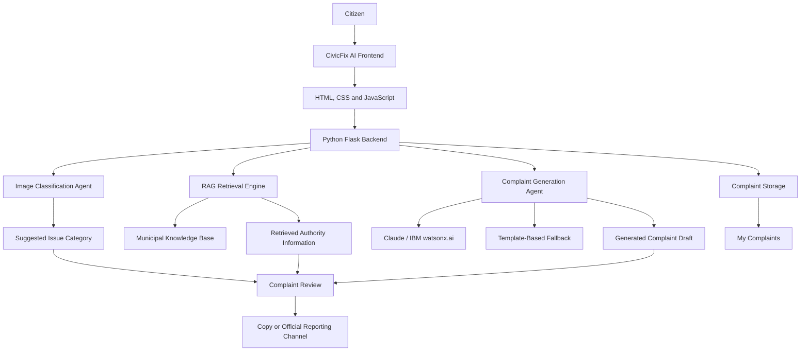
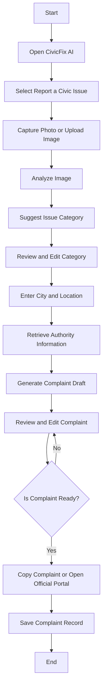

# CivicFix AI
### Capture. Report. Improve Your City.

**An AI-assisted civic complaint management platform for building cleaner, safer, and smarter communities.**

<p align="center">
  <b>UN Sustainable Development Goal 11 – Sustainable Cities and Communities</b>
</p>

---

## 1. Overview

CivicFix AI is a civic technology platform designed to simplify the process of identifying and reporting public infrastructure problems.

Citizens can capture or upload an image of a civic issue, provide its location, identify the issue category, find relevant municipal authorities, and generate a structured complaint.

The platform supports common civic issues such as:

- Road damage and potholes
- Garbage accumulation and overflowing bins
- Waterlogging and drainage problems
- Damaged public infrastructure
- Non-functional streetlights
- Other community-level civic concerns

CivicFix AI combines a web-based reporting interface with a Python backend that supports image analysis, knowledge retrieval, authority information, and AI-assisted complaint drafting.

The goal is to make civic reporting more accessible, organized, and transparent.

## 2. Problem Statement

Citizens frequently encounter civic problems but may not know:

- Which municipal department is responsible.
- Where to submit an official complaint.
- What information should be included.
- How to write a clear and effective complaint.
- How to maintain records of previously reported issues.

Traditional complaint processes can involve unnecessary steps, unclear communication, and difficulty finding the appropriate reporting channel.

CivicFix AI addresses these challenges through a single, structured digital reporting workflow.

## 3. Proposed Solution

CivicFix AI provides an integrated platform through which citizens can:

1. Capture an image using their device camera or upload an existing photograph.
2. Analyze the image to suggest a possible civic issue category.
3. Enter the city, area, and PIN code.
4. Retrieve relevant authority information using a knowledge retrieval system.
5. Generate an editable complaint using an AI provider or built-in template.
6. Review and copy the complaint or continue to an official reporting channel.
7. Maintain a personal record of submitted and saved complaints.

The platform is designed to communicate clearly when information is verified, simulated, or unavailable.

## 4. System Architecture

The application is divided into two main components:

- **Frontend:** Static HTML, CSS, and JavaScript application.
- **Backend:** Python Flask API responsible for classification logic, knowledge retrieval, complaint generation, and complaint storage.

### Architecture Diagram



## 5. Complete User Workflow



## 6. Key Features

### 6.1 Image-Based Civic Reporting

- Capture images using a device camera.
- Switch between front and rear cameras where supported.
- Upload photographs from a device.
- Analyze uploaded images to suggest an issue category.
- Allow users to review and edit the suggested category.

**Current implementation:** The image classification function uses basic image brightness and colour statistics with weighted randomness. It is a prototype placeholder, not a trained computer vision model.

### 6.2 Intelligent Issue Classification

The platform supports six issue categories through its category API.

The classification component processes an uploaded image and suggests a possible category.

The suggested result can be reviewed and edited by the citizen before proceeding.

### 6.3 Location-Based Reporting

Users can provide:

- City
- Local area
- PIN code
- Issue location

The application also includes an illustrative tap-to-pin map interface.

A production mapping SDK and real geocoding service can be integrated in a future version.

### 6.4 RAG-Based Authority Retrieval

CivicFix AI uses a Retrieval-Augmented Generation (RAG) approach to retrieve relevant information from its local knowledge base.

The knowledge base includes:

- Verified Hyderabad/GHMC information.
- Verified CPGRAMS national grievance portal information.
- Available municipal authority information.
- Category-specific complaint reporting guidance.

The current retrieval system uses TF-IDF-style term-frequency cosine similarity, with additional relevance weighting for the requested city and issue category.

It works without an external embedding API or vector database.

The retrieved documents are returned with the API response so that the frontend can display the information used.

### 6.5 AI-Assisted Complaint Generation

The complaint-generation component creates structured complaint drafts using retrieved information.

Supported AI providers:

| Provider | Integration |
|---|---|
| Anthropic Claude | Anthropic API |
| IBM watsonx.ai | IBM Granite models |

If an AI provider is unavailable, the backend uses a deterministic complaint template informed by the retrieved knowledge.

Users can review and edit the generated complaint before using it.

### 6.6 Complaint Management

The platform provides a personal complaint management section.

Features include:

- View saved complaints.
- Maintain complaint records.
- Track complaint status.
- Update complaint reference numbers.
- Store records locally in the browser.
- Maintain a secondary backend JSON record when the backend is available.

### 6.7 Community and Impact Dashboard

**Explore Issues**
- Displays sample community issue records.
- Provides category-based filtering.
- Shows information using a map and list interface.

**Impact Dashboard**
- Displays sample civic data.
- Provides charts and visual summaries using Chart.js.

These sections currently use demo data and should not be presented as verified live municipal reports.

## 7. Technology Stack

| Layer | Technologies |
|---|---|
| Frontend | HTML5, CSS3, JavaScript |
| Styling | Custom CSS |
| Backend | Python, Flask |
| Image Processing | Pillow (PIL) |
| Knowledge Retrieval | TF-IDF-style cosine similarity |
| AI Integration | Anthropic Claude, IBM watsonx.ai |
| Visualization | Chart.js |
| Data Storage | JSON files, Browser Local Storage |
| Communication | REST API, JSON |
| Development | Python HTTP Server |

## 8. Backend API Documentation

The Flask backend exposes the following endpoints:

| Endpoint | Method | Description |
|---|---|---|
| `/api/health` | GET | Checks backend availability |
| `/api/ai-status` | GET | Reports the configured AI provider |
| `/api/categories` | GET | Returns supported issue categories |
| `/api/classify` | POST | Processes an uploaded image |
| `/api/rag/retrieve` | GET | Retrieves relevant knowledge-base documents |
| `/api/authority` | GET | Retrieves authority information |
| `/api/generate-complaint` | POST | Generates a complaint draft |
| `/api/complaints` | GET | Retrieves saved complaints |
| `/api/complaints` | POST | Creates a complaint record |
| `/api/complaints/<id>` | PATCH | Updates complaint details |

### Example API Request

**Image Classification**

```http
POST /api/classify
Content-Type: multipart/form-data
```

The request contains an image file under the `image` field.

**Authority Retrieval**

```http
GET /api/authority?city=Hyderabad&category=pothole
```

**Knowledge Retrieval**

```http
GET /api/rag/retrieve?query=road%20damage&city=Hyderabad&category=pothole
```

**Complaint Generation**

```http
POST /api/generate-complaint
Content-Type: application/json
```

The request uses JSON containing the complaint details required by the backend.

Refer to the Flask route implementation for the exact request and response schemas.

## 9. Project Structure

```text
civicfix-ai/
│
├── README.md
│
├── frontend/
│   ├── index.html
│   ├── styles.css
│   └── script.js
│
└── backend/
    ├── app.py
    ├── requirements.txt
    │
    └── data/
        └── complaints.json
```

### Frontend

- `index.html` – Application structure and page content.
- `styles.css` – Layout, styling, and responsive design.
- `script.js` – Application logic, navigation, state management, and API communication.

### Backend

- `app.py` – Flask API, image classification, RAG retrieval, complaint generation, and complaint storage.
- `requirements.txt` – Python dependencies.
- `data/complaints.json` – File-based complaint storage, created automatically when required.

## 10. Installation and Setup

### Prerequisites

- Python 3.x
- pip
- A modern web browser
- Git (optional)

### Step 1: Clone the Repository

```bash
git clone YOUR_GITHUB_REPOSITORY_URL
```

### Step 2: Open the Project

```bash
cd civicfix-ai
```

### Step 3: Install Backend Dependencies

```bash
cd backend
pip install -r requirements.txt
```

### Step 4: Start the Flask Backend

```bash
python app.py
```

The backend runs by default at:

```text
http://127.0.0.1:5000
```

Keep the backend terminal running.

### Step 5: Start the Frontend

Open a second terminal:

```bash
cd civicfix-ai/frontend
python -m http.server 5500
```

### Step 6: Open the Application

Visit:

```text
http://localhost:5500
```

**Important:** Serve the frontend through a local web server instead of opening `index.html` directly. This helps camera access and frontend-to-backend API requests work correctly.

If the backend address changes, update the `API_BASE` constant in `frontend/script.js`.

## 11. AI Provider Configuration

CivicFix AI supports two optional AI providers.

### Anthropic Claude

Set the environment variable:

```bash
export ANTHROPIC_API_KEY="YOUR_API_KEY"
```

### IBM watsonx.ai

Set the following variables:

```bash
export WATSONX_API_KEY="YOUR_API_KEY"
export WATSONX_PROJECT_ID="YOUR_PROJECT_ID"
export WATSONX_URL="https://us-south.ml.cloud.ibm.com"
export WATSONX_MODEL_ID="ibm/granite-13b-chat-v2"
```

### Select an AI Provider

```bash
export AI_PROVIDER="watsonx"
```

For Claude:

```bash
export AI_PROVIDER="anthropic"
```

The backend checks the available configuration and reports the selected provider through `/api/ai-status`.

Do not upload API keys or credentials to GitHub.

## 12. Graceful Fallback Mechanism

CivicFix AI is designed to remain usable when the backend or external AI service is unavailable.

| Component | Normal Operation | Fallback |
|---|---|---|
| Image classification | Backend classification function | Browser demo classification |
| Authority retrieval | Backend RAG retrieval | Local demo information |
| Complaint generation | Configured AI provider | Deterministic template |
| Complaint records | Browser storage and backend JSON | Browser local storage |

The application communicates when a demo or fallback mechanism is being used.

## 13. Verified Functionality vs. Prototype Limitations

Transparency is an important part of CivicFix AI.

The project distinguishes implemented functionality from simulated or demo components.

| Component | Current Status |
|---|---|
| Frontend reporting workflow | Implemented |
| Flask backend API | Implemented |
| TF-IDF-style knowledge retrieval | Implemented |
| GHMC verified information | Included in knowledge base |
| CPGRAMS national portal information | Included in knowledge base |
| Claude integration | Supported when configured |
| IBM watsonx.ai integration | Supported when configured |
| Complaint generation fallback | Implemented |
| Complaint storage | JSON and browser local storage |
| Image classification | Simulated prototype logic |
| Community issue feed | Sample demo data |
| Impact dashboard | Sample dataset |
| Tap-to-pin map | Illustrative interface |

### Important Authority Information

The current knowledge base includes verified Hyderabad/GHMC information:

- GHMC helpline: 155304
- GHMC helpline: 040-2111-1111
- MyCURE citizen app
- Centralised Grievance Redressal System
- GHMC complaint reporting through the official website.

The national CPGRAMS portal is also available:

https://pgportal.gov.in/

Information about other municipal corporations is not supported by a complete verified contact directory in this prototype. The platform must not invent contact numbers, email addresses, or official complaint reference numbers.

## 14. Privacy and Responsible AI

CivicFix AI is designed to make civic reporting transparent and user-controlled.

Key principles:

- Users can review and edit complaint drafts.
- Retrieved information can be inspected.
- Demo classifications are identified as simulated.
- Sample dashboard data is not presented as live civic data.
- Official contact details are not invented.
- Complaint reference numbers are entered by users after receiving them from an actual authority.
- Users have a clear-data option in the application.

### Current Privacy Limitations

The current prototype stores personal complaint information in browser local storage and a backend JSON file.

It does not provide production-grade authentication or multi-user access controls.

Avoid uploading sensitive personal information to a public deployment.

## 15. Current Limitations

The following improvements are needed before production deployment:

1. Replace the simulated image classifier with a trained computer vision model or verified vision API.
2. Upgrade the TF-IDF retrieval engine to embedding-based vector search where appropriate.
3. Expand the municipal knowledge base using maintained and verified official documents.
4. Integrate a real mapping and geocoding service.
5. Replace JSON complaint storage with a secure database.
6. Add authentication and role-based access control.
7. Configure restricted CORS and production security settings.
8. Implement genuine multi-user complaint tracking.
9. Connect to official complaint submission channels only where authorized integrations exist.

## 16. Future Enhancements

- Deep-learning-based civic issue classification.
- Improved municipal knowledge retrieval.
- Verified municipal authority directory.
- Real-time location and map integration.
- Secure cloud-based complaint storage.
- Citizen and municipal authority dashboards.
- Complaint status notifications.
- Multilingual complaint generation.
- Analytics for identifying frequently reported civic problems.
- Integration with authorized municipal services.

## 17. Expected Impact

CivicFix AI aims to support more accessible civic participation by helping citizens prepare structured complaints and identify relevant reporting channels.

Potential benefits include:

- Simplifying the complaint preparation process.
- Improving the clarity of civic reports.
- Helping citizens find relevant authority information.
- Encouraging community participation.
- Supporting awareness of local infrastructure problems.
- Contributing to the objectives of Sustainable Development Goal 11.

These are intended benefits; actual improvements in municipal response times or issue resolution would require deployment and evaluation with relevant authorities.

## 18. Conclusion

CivicFix AI demonstrates how web technologies, knowledge retrieval, and AI-assisted text generation can be combined to simplify civic issue reporting.

By connecting image-based reporting, location details, authority information, and structured complaint generation, the platform provides a practical prototype for citizen-focused civic technology.

**Our vision is simple: make reporting civic problems easier, clearer, and more accessible.**

---

## Project Information

| Field | Details |
|---|---|
| Project | CivicFix AI |
| Domain | Artificial Intelligence / Civic Technology |
| Category | Smart Cities |
| SDG Alignment | UN SDG 11 |
| Frontend | HTML, CSS, JavaScript |
| Backend | Python Flask |
| AI Services | Claude / IBM watsonx.ai |
| Project Type | Hackathon Prototype |

---

<p align="center">
  <b>CivicFix AI</b><br>
  Capture. Report. Improve Your City.
</p>
